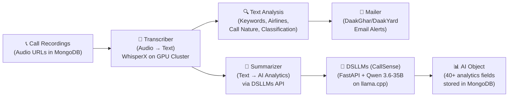
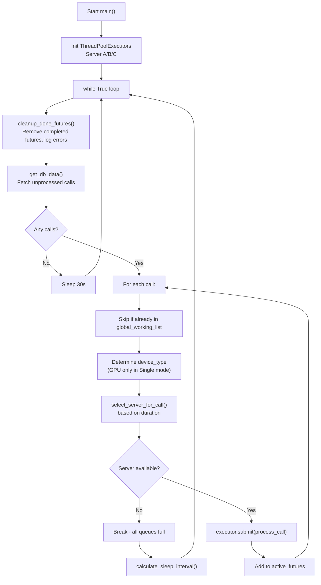
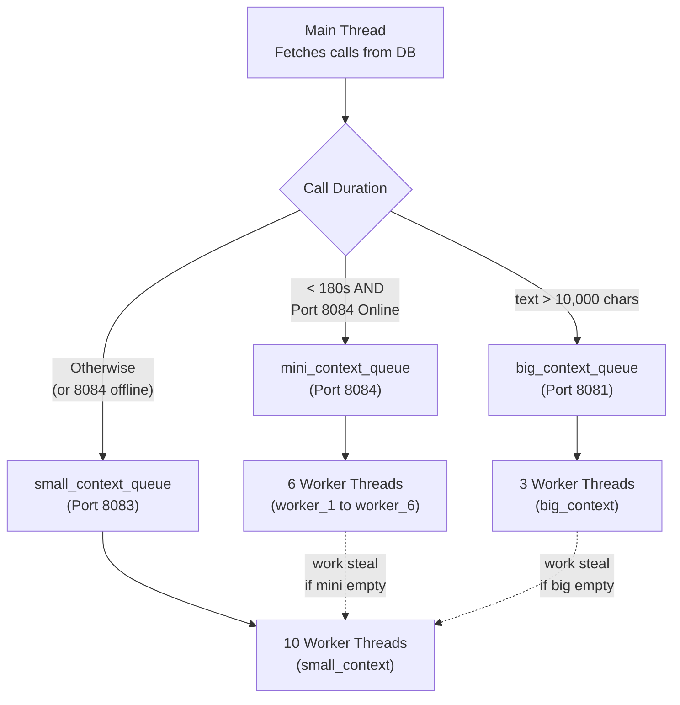
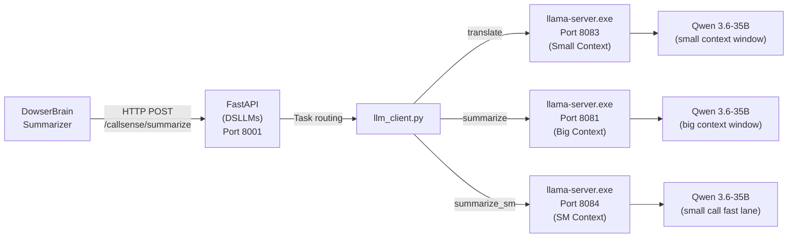
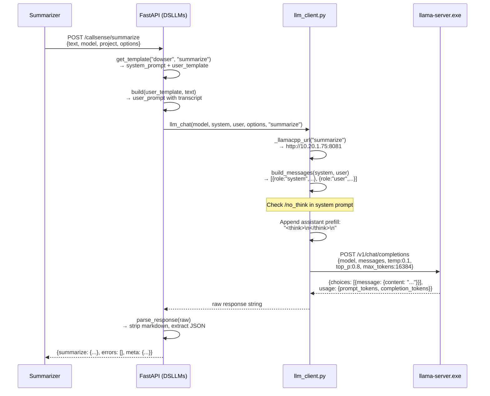
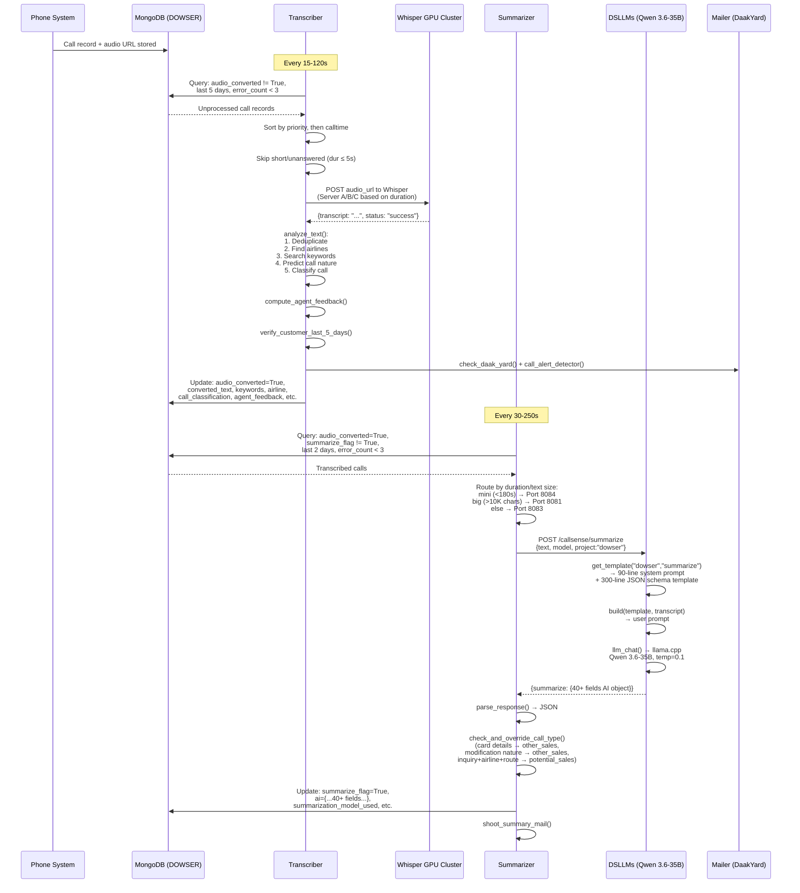

# DowserBrain — Complete Architecture Deep Dive

> **Purpose**: Full in-depth technical reference for interview preparation covering the entire pipeline:
> **Transcriber → Summarizer → DSLLMs (CallSense)**

---

## 🏗️ System Overview — The Big Picture

DowserBrain is a **call center intelligence pipeline** for a travel/airline company (Dowser). It processes phone call recordings through 3 sequential stages:



---

## 📂 File Map

| File | Role |
|------|------|
| [`transcriber.py`](file:///c:/Users/SNVA/Documents/Production/DowserBrain/transcriber.py) | Main loop: fetches unprocessed calls, dispatches to Whisper API, runs text analysis, writes results back |
| [`summarizer.py`](file:///c:/Users/SNVA/Documents/Production/DowserBrain/summarizer.py) | Picks up transcribed calls, sends text to DSLLMs for AI summarization, writes AI analytics back |
| [`functions.py`](file:///c:/Users/SNVA/Documents/Production/DowserBrain/functions.py) | Shared utilities: Whisper cluster routing, `analyze_text`, airline detection, keyword search, call classification, mailer, agent evaluation |
| [`metrics.py`](file:///c:/Users/SNVA/Documents/Production/DowserBrain/metrics.py) | Prometheus metrics for monitoring (exported to `C:\monitoring\metrics\`) |
| [`summary_mailer.py`](file:///c:/Users/SNVA/Documents/Production/DowserBrain/summary_mailer.py) | Shoots email after successful summarization |
| [`call_alert_detector.py`](file:///c:/Users/SNVA/Documents/Production/DowserBrain/call_alert_detector.py) | Detects suspicious calls (fraud, card complaints, etc.) |
| **DSLLMs** | |
| [`callsense/routes/inference.py`](file:///c:/Users/SNVA/Documents/Production/DSLLMs/callsense/routes/inference.py) | FastAPI endpoints: `/callsense/summarize`, `/callsense/summarize_sm`, `/callsense/transcribe`, `/callsense/translate` |
| [`callsense/llm_client.py`](file:///c:/Users/SNVA/Documents/Production/DSLLMs/callsense/llm_client.py) | Unified LLM client: routes tasks to correct llama.cpp server (small/big/sm context) |
| [`callsense/settings.py`](file:///c:/Users/SNVA/Documents/Production/DSLLMs/callsense/settings.py) | All configuration: server URLs, timeouts, pool sizes, model names |
| [`prompt_templates/dowser_template.py`](file:///c:/Users/SNVA/Documents/Production/DSLLMs/prompt_templates/dowser_template.py) | The actual system + user prompts for Dowser translate & summarize |
| [`prompt_templates/registry.py`](file:///c:/Users/SNVA/Documents/Production/DSLLMs/prompt_templates/registry.py) | Maps (project, task) → (system_prompt, user_template) |
| [`tools.py`](file:///c:/Users/SNVA/Documents/Production/DSLLMs/tools.py) | `build()` fills prompt template, `build_messages()` creates OpenAI-format messages, `parse_response()` extracts JSON from LLM output |

---

## 1️⃣ TRANSCRIBER — Audio to Text (transcriber.py)

### 1.1 Database & Collections

- **Target Database**: `DOWSER` (MongoDB)
- **Collections scanned**:
  1. `InternationalCalls` (IDs start with `11`)
  2. `DomesticCalls` (IDs start with `22`)
  3. `ReserveCalls` (IDs start with `33`)
  4. `CrmCallRecords` (IDs start with `44` or contain `.`)
  5. `crmCallRecords_ggn`

### 1.2 Data Fetching — `get_db_data()`

The transcriber fetches calls that need processing with this query logic:

```python
query = {
    "$or": [
        {"audio_converted": {"$nin": [True, "skipped", "processing"]}},
        {
            "audio_converted": "processing",
            "processing_start_time": {"$lt": thirty_minutes_ago}  # stuck jobs
        }
    ],
    "transcribe_error_count": {"$not": {"$gte": 3}},  # max 3 retries
    "calltime": {"$gte": five_days_ago},               # only last 5 days
    # Must have at least one recording URL
    "$and": [{"$or": [
        {"recordingpath": {"$exists": True, "$ne": None, "$ne": ""}},
        {"recordingpath1": {"$exists": True, "$ne": None, "$ne": ""}},
        {"audiopath": {"$exists": True, "$ne": None, "$ne": ""}}
    ]}]
}
```

**CrmCallRecords** uses a different query (`query_crm`) that also checks:
- `recording_available: True`
- `recording_pending: False`
- Handles `calltime` as both datetime and string formats

> [!IMPORTANT]
> **Short/Unanswered Calls Bypass**: Any call with `duration ≤ 5` seconds OR disposition `"NO ANSWER"`, `"FAILED"`, `"BUSY"` is immediately handled via `get_short_call_fallback()` — it generates a stub AI object with default values and marks `audio_converted: "skipped"`. These never hit the Whisper API.

### 1.3 Priority Sorting

After fetching, calls are sorted by:
1. **Priority**: `high` → `medium` → `low` (using Pandas Categorical)
2. **Calltime**: newest first (descending)

### 1.4 Whisper GPU Cluster — 3-Server Architecture

Three physical GPU servers handle transcription:

| Server | IP | Primary For | Env Key |
|--------|-----|------------|---------|
| **Server_A** | `10.20.1.75` | Long calls ≥ 180s | `API_CALLSENSE_TRANSCRIBER` |
| **Server_B** | `10.20.1.110` | Medium calls 45s–180s | `API_CALLSENSE_TRANSCRIBER_B` |
| **Server_C** | `10.20.1.111` | Short calls < 45s | `API_CALLSENSE_TRANSCRIBER_C` |

#### Server Selection Logic (`select_server_for_call`)

```
Duration < 45s   → Preferred: C, Overflow: C → B → A
45s ≤ dur < 180s → Preferred: B, Overflow: B → A (never C)
Duration ≥ 180s  → Preferred: A, Overflow: A → B (never C)
```

> [!NOTE]
> **SERVER_C is exclusively for short calls** — long/medium calls NEVER overflow to Server_C. This prevents a long call from blocking the short-call server.

#### Fallback Chain (`call_whisper_api`)

Each server attempt follows a **priority chain** with automatic failover. If the primary server returns non-200 or throws an exception, the next server in the chain is tried. The response tracks `api_was_fallback: True/False`.

#### ThreadPool Executors

Each server gets its own `ThreadPoolExecutor` with configurable threads:

```python
max_threads_a = int(os.getenv("MAX_THREADS_A", 5))   # default 5
max_threads_b = int(os.getenv("MAX_THREADS_B", 3))   # default 3
max_threads_c = int(os.getenv("MAX_THREADS_C", 1))   # default 1
```

Each also has a **queue capacity limit** (`MAX_QUEUE_A/B/C`). When all queues are full, dispatch pauses.

### 1.5 Whisper API Payload

```python
payload = {
    "audio_url": audio_url,     # URL to the recording file
    "lang": "auto",             # auto language detection
    "whisper_model": "large",   # OpenAI Whisper Large model
    "project": "dowser",
    "whisper_task": "translate", # output directly in English
    "device": "gpu"
}
```

> [!TIP]
> **`whisper_task: "translate"`** means WhisperX outputs English text directly, regardless of the call's language. This eliminates the need for a separate LLM translation step for most calls.

### 1.6 Post-Transcription Text Analysis — `analyze_text()`

After Whisper returns text, `analyze_text()` in [`functions.py`](file:///c:/Users/SNVA/Documents/Production/DowserBrain/functions.py#L1089-L1122) performs 5 analyses:

#### 1. Text Deduplication (`remove_repeated_sentence_words`)
Recursively removes repeated consecutive sentences/words at multiple separator levels (`.`, `,`, `?`, ` `). Whisper sometimes stutters and repeats segments.

#### 2. Airline Detection (`find_airlines`)
- Loads `airline_variants.json` — a map of airline names → variant names/codes
- Uses **word-boundary regex** matching (not substring) to prevent false positives
- Special handling for ambiguous names: `"united"` (not "United States"), `"american"` (not "American Express"), `"delta"`, `"sky"` (not "Skype"), `"france"`, etc.
- IATA codes (2-3 letter) are matched in 3 ways:
  - **Glued to flight number**: `JU786` — always trusted
  - **Spaced from flight number**: `JU 786` — trusted for non-common-word codes
  - **Bare word**: only for 3+ letter codes or hardcoded exceptions like `"ai"` (Air India)
- Common English words that are also IATA codes (`at`, `as`, `me`, `ok`, `no`, `am`, `pm`) require **contextual evidence** (nearby travel keywords like "airline", "flight with", "booked with") before confirming
- Results are ordered by their position in the transcript

#### 3. Keyword Search (`search_keywords`)
- Loads keywords from `keywords.txt` (comma-separated)
- Uses word-boundary regex matching
- Also extracts numeric patterns (prices/amounts) with regex

#### 4. Call Nature Prediction (`predict_callnature`)
Keyword-based classification into groups:
- **New Booking**: "a new booking", "buy a flight", "book a flight", etc.
- **Sales**: "payment", "credit", "debit", "card number", "refund", "cancellation", etc.
- **Potential**: "change", "cancel", "pet", "correction", etc.
- Uses a **mode function** with priority: `New Booking > Sales > Potential > Non-Sales`

#### 5. Call Classification (`classify_call`)
A more sophisticated 3-level classification using `keyword_categories.json`:

```
Travel Type:  travel | non_travel | unknown
├── Sub Type: sales | non_sales
└── Category: new_booking | baggage | bank | isp | etc.
```

- **Step 1 — Entity Detection**: Checks for travel entities (airlines, hotels) and non-travel entities (banks, ISPs) using brand names from `keywords.json` and `airline_variants.json`
- **Step 2 — Keyword Matching**: Matches keywords from travel > sales, travel > non_sales, and non_travel categories
- **Step 3 — Combined Decision**: Entity detection overrides keyword-based `travel_type`; confidence = `high` (entity + 3+ keywords), `medium` (entity OR 2+ keywords), `low` (otherwise)

### 1.7 Booking Override Logic

If the call document has a `booking` object with an ID or non-empty data, `callnature` is forced to `"Sales"` and classification category to `"sales"` — the assumption being if there's a booking record, it's a sales call.

### 1.8 Agent Feedback (`compute_agent_feedback`)

Evaluates 4 agent performance parameters from the transcript:

| Parameter | What It Checks |
|-----------|---------------|
| **Opening Line** | Greeting, name introduction, offer to assist (first 3 lines) |
| **Email Collection** | Actual email address OR agent asking for one |
| **Alt Phone Collection** | Agent asks for alternate/callback number |
| **Closing Line** | "Anything else?", "Have a great day", thank you (last 3 lines) |

**Rating**: 1 (0/4 done) to 5 (all 4 done)

### 1.9 Customer Verification (`verify_customer_last_5_days`)

Checks if the same phone number has called in the last 5 days across all collections. Searches by `custnumber`, `customer_number`, `phone_number`, and `cli` fields.

### 1.10 Email Dispatch — DaakGhar/DaakYard System

After transcription, `handle_dowser_mail()` → `check_daak_yard()`:

1. Loads **master email rules** from `DSUITE.DaakGhar` collection (active rules)
2. Filters rules by: date range, queue, TFN, extension, keywords in text, call duration
3. Matching rules create entries in `DSUITE.DaakYard` (email queue)
4. Also runs `call_alert_detector` for suspicious calls (card complaints, fraud, etc.)

### 1.11 Database Updates After Transcription

On **success**:
```python
{
    "audio_converted": True,
    "transcribe_flag": True,
    "converted_text": "...",
    "converted_text_length": 1234,
    "keywords_found": "booking,flight,...",
    "airline": "Delta|United",
    "numbers_found": "...",
    "route_found": "New York to London",
    "callnature_predicted": "Sales",
    "call_classification": {...},
    "agent_feedback": {...},
    "customer_verification": {...},
    "api_server_used": "Server_A [10.20.1.75]",
    # ... plus email_sent status
}
```

On **API error**: increments `transcribe_error_count`. After 3 errors → `audio_converted: "skipped"`. Special handling for OOM errors, index errors, and 404s (immediate skip).

> [!NOTE]
> **Dual Database Writes**: Every update goes to BOTH the remote MongoDB (`DATABASE_URL`) AND a local MongoDB (`LOCAL_MONGO_URI`). The local DB is a replica for faster reads.

### 1.12 Main Loop Flow



### 1.13 Sleep Intervals

```python
def calculate_sleep_interval(pending_db_count, total_active):
    if pending == 0 and active == 0: return 30   # Idle
    elif active > 0:                 return 15   # Active processing
    elif pending < 10:               return 60   # Light load
    else:                            return 120  # Heavy load
```

---

## 2️⃣ SUMMARIZER — Text to AI Analytics (summarizer.py)

### 2.1 Data Fetching

Picks up calls that have been transcribed but NOT yet summarized:

```python
query = {
    "audio_converted": True,                           # must be transcribed
    "summarize_flag": {"$nin": [True, "skipped"]},     # not yet summarized
    "summarize_error_count": {"$not": {"$gte": 3}},    # max 3 retries
    "calltime": {"$gte": two_days_ago}                 # only last 2 days
}
```

Sorting: **Priority** (high → medium → low), then **Duration** (longest first — descending).

> [!IMPORTANT]
> **Key difference from transcriber**: Summarizer sorts by duration (longest first) while transcriber sorts by calltime (newest first). This ensures the longest, most complex calls get summarized first.

### 2.2 Three-Queue Architecture

The summarizer uses **3 Python `queue.Queue` objects** to route calls by size:



#### Routing Logic (Main Thread):
```python
if call_duration < 180 and is_8084_up:
    mini_context_queue.put(item)      # → Port 8084 (fast, small calls)
elif text_len > 10000:
    big_context_queue.put(item)       # → Port 8081 (big context window)
else:
    small_context_queue.put(item)     # → Port 8083 (standard)
```

### 2.3 Worker Thread Pool — 19 Total Threads

| Thread Type | Count | Queue | LLM Port | Work Stealing |
|------------|-------|-------|----------|---------------|
| `small_context` | 10 | small_context_queue | 8083 | — |
| `big_context` | 3 | big_context_queue | 8081 | Steals from small_context_queue |
| `worker_1`–`worker_6` (mini) | 6 | mini_context_queue | 8084 (with fallback to 8083) | Steals from small_context_queue |

#### Work Stealing Pattern:
- **Mini workers**: First check `mini_context_queue`. If empty, steal from `small_context_queue`.
- **Big workers**: First check `big_context_queue`. If empty, steal from `small_context_queue`.
- **Small workers**: Only check `small_context_queue`.

### 2.4 Port 8084 Health Check

```python
def check_8084_status(force=False):
    # Caches result for 30 seconds to avoid network overhead
    # Hits http://10.20.1.75:8084/health with 1.5s timeout
    # If offline, all small calls auto-fallback to 8083
```

> [!TIP]
> Port 8084 is an optional "fast lane" for short calls. If it's down, the system automatically routes everything through 8083/8081 — no manual intervention needed.

### 2.5 Summarization — `convert_audio()` (misleading name, it's text→AI)

#### Model Selection:
```python
is_big_context = text_len > 10000
model_to_use = "qwen3.6-35b-big-context" if is_big_context else "qwen3.6-35b-small-contaxt"
```

#### API Payload to DSLLMs:
```python
data = {
    "text": converted_text,          # the transcript text
    "summarize_model": model_to_use, # model routing hint
    "project": "dowser",             # selects prompt template
    "options": {
        "temperature": 0.1,          # very low for factual extraction
        "top_p": 0.8,
        "think": False               # disable chain-of-thought
    }
}
```

#### API Endpoint Selection:
- Mini workers try `API_CALLSENSE_SUMMARIZER_SM` (port 8084) first
- If 8084 fails → automatic fallback to `API_CALLSENSE_SUMMARIZER` (port 8083/8081)
- Non-mini workers always use `API_CALLSENSE_SUMMARIZER`

### 2.6 Short/Empty Call Handling

Calls with `< 75 characters` of transcript text bypass DSLLMs entirely and use `get_short_call_fallback()`, which returns a default AI object:

```python
{
    "call_summary": ["Short call / Greeting only / Hang up"],
    "call_type": "undecided",
    "call_nature": "short_duration",
    "call_quality": "average",
    "agent_effort_scale": 1,
    "agent_mood": "neutral",
    "customer_mood": "neutral",
    # ... 40+ fields with defaults
}
```

### 2.7 Call Type Override — `check_and_override_call_type()`

After DSLLMs returns the AI object, the summarizer runs a **post-processing override** to catch cases the LLM might miss:

#### Override 1 — Card Details → `other_sales`
If ANY card-related field is present (`card_number`, `cvv`, `expiry_date`, `payment_mode` = credit/debit, or `deal_finalized` + payment received), override to `other_sales`.

#### Override 2 — Modification Nature → `other_sales`
If `call_nature` is in a predefined set of booking modifications:
```python
OTHER_SALES_NATURES = {
    "cancellation", "refund", "date_change", "flight_change",
    "seat_selection", "seat_upgrade", "seat_change",
    "name_correction", "booking_correction", "flight_upgrade",
    "passenger_addition", "pet_addition", "child_infant_travel",
    "baggage_addition", "ticket_reissue", "schedule_change", "flight_cancellation"
}
```

#### Override 3 — Inquiry + Airline + Route → `potential_sales` or `new_booking`
- Exact `call_nature == "inquiry"` + airline + route → `potential_sales`
- Inquiry-like (`"inquir"` substring) + airline + route → `new_booking`

### 2.8 Error Handling & Retry

- **In-memory error counter** (`call_error_counts` defaultdict) + **DB-persisted** `summarize_error_count`
- Uses the **higher** of the two counts (protects against restarts losing memory counts)
- After `MAX_RETRIES` (3) failures → `summarize_flag: "skipped"` (permanent skip)
- Historical errors are seeded from log files on startup (`_load_historical_errors`)

### 2.9 Post-Summarization Email

On successful summarization of non-empty calls:
- `shoot_summary_mail()` sends email notification
- Only for Dowser project calls (not `snva_tech_calls` or `CE_calls`)

### 2.10 Main Loop Sleep Intervals

```python
if no calls:         sleep(30)
elif < 10 calls:     sleep(100)
elif < 20 calls:     sleep(200)
else:                sleep(250)
```

> [!NOTE]
> The summarizer's sleep times are MUCH longer than the transcriber's (100-250s vs 15-120s) because summarization is GPU-intensive and batching is more efficient.

---

## 3️⃣ DSLLMs (CallSense) — The LLM Backend

### 3.1 Architecture Overview

DSLLMs is a **FastAPI application** that serves as the LLM inference gateway. It runs on port `8001` (configurable via `API_PORT`).



### 3.2 Three llama.cpp Server Instances

| Server | Port | Model Name Label | Purpose | Used By |
|--------|------|-----------------|---------|---------|
| Small Context | 8083 | `qwen3.6-35b-small-contaxt` | Translation, standard summarization | translate, default summarize |
| Big Context | 8081 | `qwen3.6-35b-big-context` | Long text summarization, chat | summarize (big texts), chat |
| SM Context | 8084 | `qwen3.6-35b-small-contaxt` | Fast lane for short calls | summarize_sm |

> [!NOTE]
> All three servers run the **same Qwen 3.6-35B model** — the "small" and "big" labels refer to the **context window size** configured in llama-server.exe (via `-c` flag), not different models. Port 8084 is an extra instance for throughput.

### 3.3 Task → Server Routing (`llm_client.py`)

```python
_TASK_TO_SERVER = {
    "translate":    "small_context",   # Port 8083
    "summarize":    "big_context",     # Port 8081
    "summarize_sm": "sm_context",      # Port 8084
    "chat":         "big_context",     # Port 8081
}
```

The `_llamacpp_url()` function resolves the actual URL using:
1. Task name (primary)
2. Model hint string (secondary — checks for "small", "big", "8b", "30b", "8084" substrings)

### 3.4 FastAPI Endpoints

#### `/callsense/summarize` (POST) — Main Summarization
```python
# Request
{
    "text": "transcript text...",
    "summarize_model": "qwen3.6-35b-big-context",
    "project": "dowser",
    "options": {"temperature": 0.1, "top_p": 0.8}
}

# Response
{
    "summarize": { /* 40+ field AI object */ },
    "errors": [],
    "meta": {
        "summarize_model": "...",
        "project": "dowser",
        "llm_backend": "llamacpp",
        "endpoint": "/callsense/summarize"
    }
}
```

#### `/callsense/summarize_sm` (POST) — Short Call Fast Lane
Same schema, routes to port 8084 (`task="summarize_sm"`).

#### `/callsense/translate` (POST) — Translation
Routes to port 8083 (small context server).

#### `/callsense/transcribe` (POST) — WhisperX Transcription
*Currently DISABLED* — transcription moved to separate DSLLMs_Transcriber service on port 8002.

#### `/callsense/all` (POST) — Full Pipeline
*Currently DISABLED* — same reason. Was a 3-bit task flag system: `100`=transcribe, `110`=transcribe+translate, `101`=transcribe+summarize, `111`=all three.

### 3.5 LLM Call Flow — `_llamacpp_chat()`



### 3.6 Key Technical Details

#### `/no_think` Mechanism
The Dowser summarize system prompt starts with `/no_think`. The `_llamacpp_chat()` function:
1. Detects `/no_think` and removes it from the prompt
2. Appends an **assistant message prefill**: `<think>\n</think>\n`
3. This tells Qwen to skip its chain-of-thought reasoning → faster, more deterministic output

#### Concurrency Control
```python
_llm_semaphore = asyncio.Semaphore(settings.LLAMACPP_CONCURRENCY)  # default: 20
```
Caps Python threads to match llama.cpp's `-np` (number of parallel) slots.

#### Timeout
All LLM calls timeout at `420 seconds` (7 minutes) by default.

#### Automatic Fallback (Port 8084 → 8083)
If port 8084 (SM server) is down, `_llamacpp_chat()` catches the HTTP error and automatically retries on port 8083 (small context server).

#### HTTP Transport
Uses `httpx` with `retries=3` at the transport layer for automatic TCP-level retries.

### 3.7 Prompt Template System

Templates are managed via a registry pattern:

```
prompt_templates/
├── registry.py              # Maps (project, task) → (system_prompt, user_template)
├── dowser_template.py       # DOWSER_SUMMARIZE_SYSTEM + DOWSER_SUMMARIZE_TEMPLATE
├── dowser_think_template.py # With chain-of-thought enabled
├── dowser_normal_template.py
├── aurora_template.py       # Aurora project templates
├── techtalk_template.py     # TechTalk project templates
└── chat_template.py
```

#### Dowser Summarize Prompt

**System prompt** (`DOWSER_SUMMARIZE_SYSTEM`): ~90 lines of expert instructions covering:
- Financial transaction analysis (track pricing → negotiation → confirmation)
- Deal finalization detection (explicit confirmation phrases)
- Agent abuse detection (swear words → flag + exact words)
- Suspicious payment detection (personal accounts → theft_alert)
- Compliance flag (inherits from theft_alert + abuse flags)
- Call transfer detection
- **Detailed call_type classification rules**:
  - `new_booking`: Concrete travel intent (route + date + passengers)
  - `potential_sales`: Generic/exploratory pricing inquiry
  - `other_sales`: Existing booking modification (cancellation, date change, seat upgrade, etc.)
  - `non_sales`: No purchase intent
- Wrong-number call handling with specific `call_nature` suffixes (`bank_call`, `isp_call`, etc.)

**User template** (`DOWSER_SUMMARIZE_TEMPLATE`): Defines the JSON schema with **40+ fields** the LLM must extract, including:

| Category | Fields |
|----------|--------|
| **Call Classification** | `call_type`, `call_nature`, `call_quality`, `travel_call`, `call_status` |
| **Summary** | `call_summary[]`, `call_type_reason`, `call_nature_reason` |
| **People** | `agent_name`, `customer_name`, `agent_mood`, `customer_mood` |
| **Travel Details** | `airline`, `other_airlines`, `flight_number`, `travel_date`, `origin`, `destination`, `country`, `passenger_count`, `booking_reference` |
| **Financials** | `payment_received`, `payment_mode`, `card_number`, `expiry_date`, `cvv`, `amount_discussed`, `deal_finalized`, `finalized_amount` |
| **Agent Quality** | `agent_effort_scale`, `agent_behavior_signals{}` (5 dimensions), `conversation_control`, `conflict_level` |
| **Satisfaction** | `customer_satisfaction_estimate`, `call_difficulty` |
| **Risk/Compliance** | `theft_alert`, `compliance_flag`, `agent_abusive_words_flag`, `escalation_flag`, `escalation_risk` |
| **Follow-up** | `follow_up_required`, `follow_up_reason`, `key_topics[]` |
| **Transfer** | `transfer_requested`, `transfer_language` |
| **Other** | `phone_number`, `repeated_customer`, `language_detected` |

### 3.8 Response Parsing (`parse_response`)

```python
def parse_response(raw):
    text = str(raw)
    text = re.sub(r"```(?:json)?", "", text)  # Strip markdown fences
    match = re.search(r"\{.*\}", text, re.DOTALL)  # Extract first JSON block
    return json.loads(match.group(0))
```

---

## 4️⃣ Monitoring & Observability

### Prometheus Metrics

Both transcriber and summarizer export `.prom` files to `C:\monitoring\metrics\`:

**Transcriber metrics**:
- `dowser_transcriber_calls_total` (Counter: worker, status, device)
- `dowser_transcriber_pending_calls` (Gauge)
- `dowser_transcriber_heartbeat_timestamp_seconds` (Gauge)

**Summarizer metrics**:
- `dowser_summarizer_tasks_total` (Counter: worker, status)
- `dowser_summarizer_pending_tasks` (Gauge)
- `dowser_summarizer_small_queue_size` / `big_queue_size` (Gauge)
- `dowser_summarizer_heartbeat_timestamp_seconds` (Gauge)

These are picked up by `windows_exporter` on port 9182 (likely scraped by Prometheus/Grafana).

### Script Activity Tracking

Both scripts write heartbeats to `DSUITE.ScriptsActivity`:
```python
collection.update_one(
    {"_id": "dowser_transcriber"},
    {"$set": {"transcriber_success": datetime.now()}}
)
```

---

## 5️⃣ End-to-End Data Flow — Complete Lifecycle of a Call



---

## 6️⃣ Key Interview Points — Things to Emphasize

### Architecture Decisions

1. **Why 3 Whisper servers?** — Load balancing by call duration. Short calls need less GPU memory, so Server_C can handle more of them. Long calls need sustained GPU, so Server_A is dedicated. Prevents short calls from being queued behind long ones.

2. **Why 3 LLM servers?** — Same Qwen model but different context window sizes. Big context (8081) handles 10K+ char transcripts. Small context (8083) is faster for standard calls. Port 8084 is an extra throughput lane for short calls.

3. **Why `/no_think`?** — Qwen 3.6 supports chain-of-thought reasoning in `<think>` tags. For structured JSON extraction, thinking wastes tokens and time. The `/no_think` prefix + assistant prefill forces the model to skip reasoning and jump straight to the JSON output.

4. **Why dual MongoDB (remote + local)?** — The remote DB is the source of truth. The local DB is a read replica for faster queries (especially for `verify_customer_last_5_days` which scans multiple collections).

5. **Why keyword-based classification AND LLM-based?** — The keyword-based `analyze_text()` runs at transcription time (fast, rule-based). The LLM-based summarization runs later (slower, more accurate). The `check_and_override_call_type()` acts as a third layer to catch LLM misclassifications using business rules.

### Performance Numbers

- **Whisper timeout**: 600s (10 min) per call
- **LLM timeout**: 420s (7 min) per summarization
- **Concurrency**: Up to 20 parallel LLM requests
- **Transcriber threads**: 5 (Server A) + 3 (Server B) + 1 (Server C) = 9
- **Summarizer threads**: 10 (small) + 3 (big) + 6 (mini) = 19

### Error Resilience

- **3-retry policy** for both transcription and summarization
- **Automatic server failover** (Whisper: A↔B↔C, LLM: 8084→8083)
- **Stuck job recovery**: Jobs marked as "processing" for >30 min are re-queued
- **Historical error loading**: Summarizer reads past log files on startup to seed error counts
- **Global working list**: Prevents duplicate processing across threads (thread-safe with Lock)

### Business Logic Highlights

- **Short call bypass** (≤5s or unanswered): No Whisper, no LLM — instant stub AI object
- **Booking object override**: If CRM has a booking record → force `call_type: "Sales"`
- **Card detail override**: If card_number/cvv/expiry present → force `other_sales`
- **Airline detection**: 2-stage (exact name → variant matching with false positive filtering)
- **DaakGhar/DaakYard**: Rule-based email system with queue/TFN/extension/keyword/duration filtering

