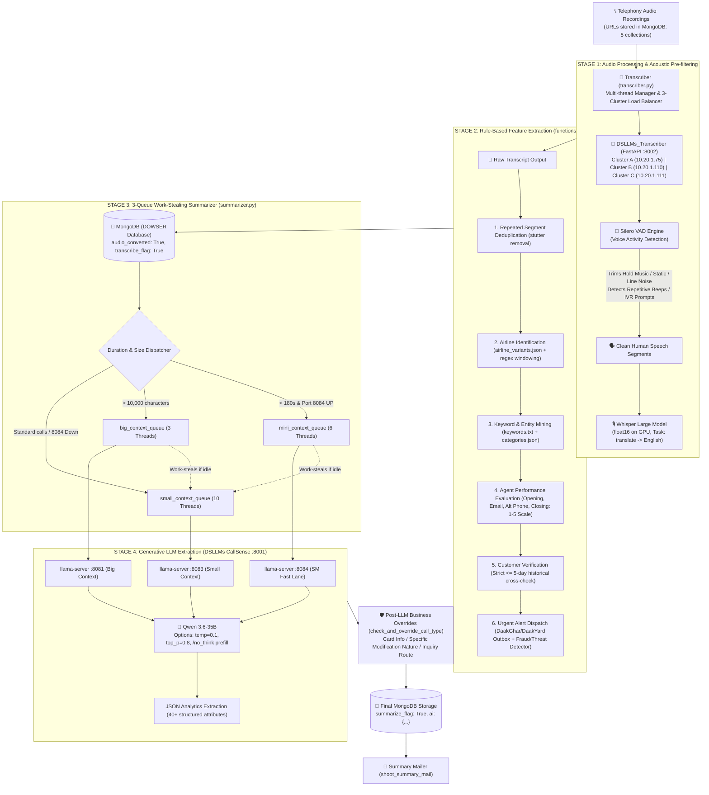
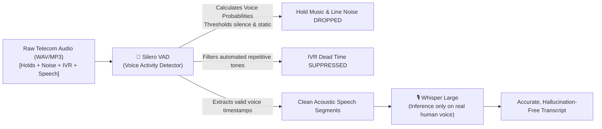
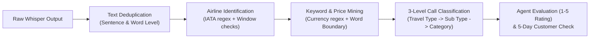
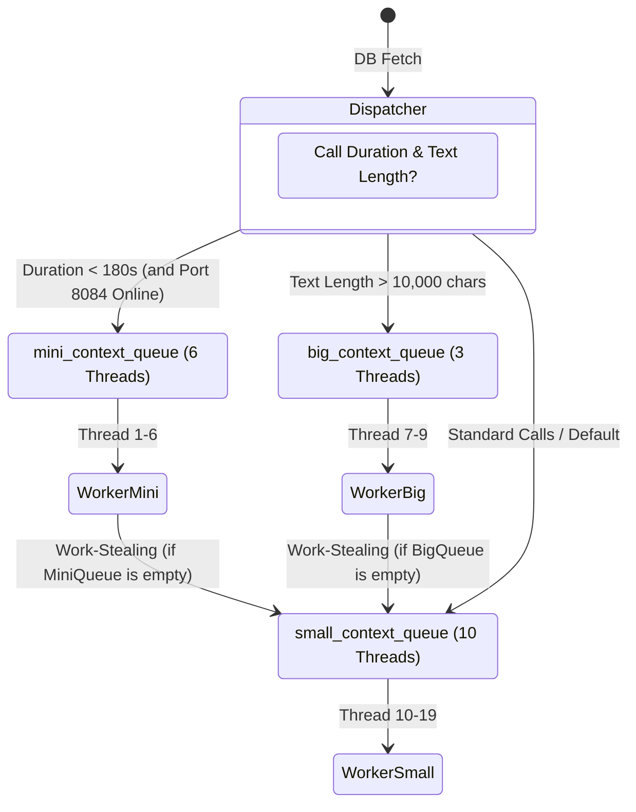
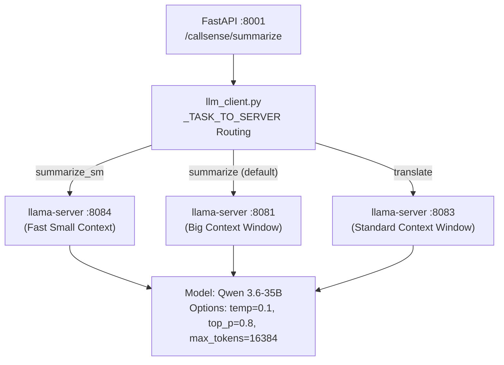

# DowserBrain — Complete Architecture Deep Dive

> **Purpose**: Full in-depth technical reference for interview preparation covering the entire pipeline:
> **Transcriber → DSLLMs_Transcriber (Whisper + Silero VAD) → Summarizer → DSLLMs (CallSense)**

---

## 🏗️ System Overview — The Big Picture

DowserBrain is an enterprise **call center intelligence pipeline** for a travel/airline organization (Dowser). It automatically converts raw telephony recordings into rich, multi-dimensional business analytics through a resilient, decoupled architecture:



---

## 📂 File & Service Architecture Map

| Service / File | Technology | Port / Endpoint | Core Purpose |
| :--- | :--- | :--- | :--- |
| **`transcriber.py`** | Python, ThreadPoolExecutor, PyMongo | Local script | Coordinates batch fetching, cluster routing (Servers A/B/C), and fallback execution. |
| **`DSLLMs_Transcriber`** | FastAPI, WhisperX (`load_model`), **Silero VAD** | `:8002/callsense/transcribe` | Dedicated GPU speech engine: strips IVR/hold music with Silero VAD, then runs Whisper Large inference. |
| **`functions.py`** | Python, Regex, Pandas | Utility module | Cluster route calculations, regex airline identification, DaakGhar mailer routing, agent rating, 5-day phone check. |
| **`summarizer.py`** | Python, multi-queue, 19 daemon threads | Local script | 3-queue orchestrator with dynamic health monitoring of port 8084 and work-stealing pattern. |
| **`DSLLMs` (CallSense)** | FastAPI, `httpx`, llama.cpp | `:8001/callsense/summarize` | LLM Gateway managing prompt templates, `/no_think` acceleration, and llama-server routing. |
| **`llama-server.exe`** | llama.cpp (OpenAI API compliant) | `:8081`, `:8083`, `:8084` | Hosting Qwen 3.6-35B at varying context window lengths (`-c` flag). |
| **`metrics.py`** | `prometheus_client` | Writes `.prom` files | Thread-safe performance telemetry consumed by `windows_exporter` on `:9182`. |

---

## 1️⃣ ACOUSTIC STAGE: DSLLMs_Transcriber (Whisper + Silero VAD)

### 1.1 The Crucial Role of Silero VAD (Noise Cancellation & IVR Suppression)
Raw call center recordings contain huge amounts of non-speech acoustic artifacts:
1. **Long Hold Music & Ringing Tones**: Customers put on hold by agents or queues.
2. **IVR Auto-Attendant Prompts**: Pre-recorded automated systems ("Press 1 for Reservations, Press 2 for Changes...").
3. **Background Call Floor Static / Cross-Talk**: Noise from dozens of other agents talking in the room.

Standard Whisper models often **hallucinate heavily** or loop endlessly when fed continuous hold music or dead air.



#### Code Implementation in `DSLLMs_Transcriber/callsense`:
In `settings.py`:
```python
# settings.py
COMPUTE_TYPE_GPU: str = "float16"
VAD_METHOD: str = "silero"    # Uses Silero Neural VAD instead of energy thresholding
TRANSCRIBE_TIMEOUT_SECONDS: int = 420
```

In `model_manager.py`:
```python
# model_manager.py
instance = whisperx.load_model(
    wx_name,                           # "large-v3" / "large"
    device=self._wx_device,            # "cuda"
    vad_method=settings.VAD_METHOD,    # "silero"
    compute_type=self._compute,        # "float16"
)
```
- **Silero VAD** analyzes acoustic speech probabilities (sample by sample). It slices the audio into pure human conversational intervals and ignores static noise, line hums, and continuous music.
- **Whisper** then transcribes *only* those targeted speech chunks, drastically reducing GPU execution time and eliminating infinite hallucination loops.

---

## 2️⃣ TRANSCRIBER CLIENT: Batch Control & GPU Clustering (`transcriber.py`)

### 2.1 Database Scanning & Fetching
Scans the `DOWSER` database across 5 specific collections:
- `InternationalCalls` (ID prefix `11`)
- `DomesticCalls` (ID prefix `22`)
- `ReserveCalls` (ID prefix `33`)
- `CrmCallRecords` (ID prefix `44` or containing `.`)
- `crmCallRecords_ggn`

#### Fetch Query Logic:
```python
query = {
    "$or": [
        {"audio_converted": {"$nin": [True, "skipped", "processing"]}},
        {
            "audio_converted": "processing",
            "processing_start_time": {"$lt": thirty_minutes_ago} # Auto-recovers stalled tasks
        }
    ],
    "transcribe_error_count": {"$not": {"$gte": 3}}, # Max 3 attempts
    "calltime": {"$gte": five_days_ago},              # Strict 5-day boundary
    "$and": [{"$or": [
        {"recordingpath": {"$exists": True, "$ne": None, "$ne": ""}},
        {"recordingpath1": {"$exists": True, "$ne": None, "$ne": ""}},
        {"audiopath": {"$exists": True, "$ne": None, "$ne": ""}}
    ]}]
}
```

> [!IMPORTANT]
> **Acoustic Short Call / Unanswered Bypass**:
> If `duration <= 5` seconds OR `disposition` is `NO ANSWER`, `FAILED`, or `BUSY`:
> It bypasses the entire GPU cluster via `get_short_call_fallback()`. It marks `audio_converted: "skipped"` and writes a pre-formed dummy AI schema, saving massive GPU cycles.

### 2.2 Three-Server GPU Cluster & Load Balancing

Calls are categorized by acoustic duration to balance GPU VRAM load across three physical machines:

| Server Node | Machine IP | Target Call Profile | Thread Limit | Queue Capacity | Primary Env Key |
| :--- | :--- | :--- | :--- | :--- | :--- |
| **Server_A** | `10.20.1.75` | **Long Calls** (`>= 180s`) | 5 Threads | 20 Slots | `API_CALLSENSE_TRANSCRIBER` |
| **Server_B** | `10.20.1.110` | **Medium Calls** (`45s - 180s`) | 3 Threads | 30 Slots | `API_CALLSENSE_TRANSCRIBER_B` |
| **Server_C** | `10.20.1.111` | **Short Calls** (`< 45s`) | 1 Thread | 30 Slots | `API_CALLSENSE_TRANSCRIBER_C` |

#### Routing & Failover Chain (`select_server_for_call`):
```
Duration < 45s   -> Preferred: SERVER_C | Overflow Chain: C -> B -> A
45s <= dur <180s -> Preferred: SERVER_B | Overflow Chain: B -> A (NEVER C)
Duration >= 180s -> Preferred: SERVER_A | Overflow Chain: A -> B (NEVER C)
```
*Why Server_C never takes long calls*: A single 20-minute audio file sent to Server_C would choke its queue and block hundreds of quick 20-second calls from clearing.

---

## 3️⃣ POST-TRANSCRIPTION FEATURE EXTRACTION (`functions.py`)

As soon as Whisper + Silero VAD returns raw text, `analyze_text()` runs locally on the CPU:



### 3.1 Text Stutter Removal (`remove_repeated_sentence_words`)
Recursively traverses text across 4 boundary delimiters: `[" ", ",", "?", "."]`. Cleans duplicated speech loops caused by degraded phone audio.

### 3.2 Context-Aware Airline Detection (`find_airlines`)
Uses `airline_variants.json`. Avoids false positives using windowed regex lookups:
- **Glued Code+Number**: `JU786` -> Instantly tagged as Air Serbia (`JU`).
- **Spaced Code+Number**: `JU 786` -> Verified for non-colliding codes.
- **Collision-Prone Common Words**: Codes that collide with everyday English words (`at`, `as`, `me`, `ok`, `no`, `am`, `pm`) are **strictly prohibited** from matching bare words. They require a ±200 character window containing aviation true-positives ("airline", "flight with", "booked with", "ticket").

### 3.3 Agent Compliance & Quality Grading (`compute_agent_feedback`)
Checks 4 conversational checkpoints:
1. **Opening Line (Greeting)**: First 3 dialogue turns checked for greeting, agent name, and assistance offer.
2. **Email Collection**: Full text checked for email collection or agent solicitation.
3. **Alternative Phone Collection**: Checks if backup or callback numbers were requested.
4. **Closing Line**: Last 3 dialogue turns checked for resolution confirmation, polite farewell.

$$\text{Agent Rating} = 1 + \sum(\text{Opening}, \text{Email}, \text{AltPhone}, \text{Closing}) \quad [\text{Score Range: } 1 \text{ to } 5]$$

### 3.4 5-Day Phone Verification (`verify_customer_last_5_days`)
Extracts the trailing 10 digits of caller phone numbers and searches the prior 5-day window across all collections. Flags whether the caller is a repeat customer or new caller.

### 3.5 DaakGhar / DaakYard Rule Engine & Fraud Detector
Evaluates matching rules against `DSUITE.DaakGhar` (filtered by active date, queues, TFNs, extensions, keywords, and durations). Qualified records are inserted into `DSUITE.DaakYard` for transactional alerting, alongside high-risk fraud triggers (card complaints, abusive language).

---

## 4️⃣ SUMMARIZER: Multi-Queue Work-Stealing Pattern (`summarizer.py`)

### 4.1 Data Fetching & Prioritization
Fetches transcribed documents where `audio_converted: True` and `summarize_flag` is not true.
- Sorted by **Priority** (high -> medium -> low), then **Duration (Descending)**.
- *Reasoning*: Long, complex calls that require the most LLM computation are scheduled first to prevent queue tail latency.

### 4.2 Three-Queue Architecture & Work-Stealing



- **Mini Context Workers (6 threads)**: Dedicated to calls `< 180s` routed to port 8084. If `mini_context_queue` runs empty, workers immediately work-steal from `small_context_queue`.
- **Big Context Workers (3 threads)**: Dedicated to long transcripts `> 10,000` chars routed to port 8081. If `big_context_queue` is empty, they work-steal from `small_context_queue`.
- **Small Context Workers (10 threads)**: Dedicated to standard load on port 8083.

### 4.3 Port 8084 Dynamic Health Circuit-Breaker
`check_8084_status()` runs an HTTP probe against `http://10.20.1.75:8084/health` (cached for 30 seconds). If port 8084 drops or errors out, the pipeline automatically redirects all mini traffic to the small context engine (port 8083) without service interruption.

### 4.4 Post-LLM Business Rule Overrides (`check_and_override_call_type`)
LLMs can occasionally misclassify nuanced financial transactions. The summarizer enforces hard deterministic overrides on the generated AI object:
1. **Financial Card Detection -> `other_sales`**:
   If card numbers, CVVs, expiration dates, or debit/credit card payment modes are present -> forces `call_type = "other_sales"`.
2. **Airline Modification Intent -> `other_sales`**:
   If `call_nature` matches modification operations (`cancellation`, `refund`, `date_change`, `seat_upgrade`, `baggage_addition`, `ticket_reissue`) -> forces `call_type = "other_sales"`.
3. **Inquiry with Route Info -> `new_booking` or `potential_sales`**:
   If origin/destination pairs and airlines are identified, exploratory requests are promoted out of generic non-sales.

---

## 5️⃣ DSLLMs (CallSense): Generative LLM Gateway

### 5.1 FastAPI Endpoint Routing (`inference.py`)
Exposes `/callsense/summarize` and `/callsense/summarize_sm` on port `8001`.



### 5.2 The `/no_think` Optimization Mechanism
Qwen 3.6 models natively support chain-of-thought tokens inside `<think>...</think>` containers. For high-volume structured JSON generation, emitting hundreds of thinking tokens wastes GPU time and creates parsing overhead.

#### Implementation:
1. The Dowser system prompt begins with `/no_think`.
2. `llm_client.py` strips `/no_think` from the system instruction.
3. It appends an **Assistant Message Prefill**:
   ```python
   messages.append({"role": "assistant", "content": "<think>\n</think>\n"})
   ```
4. **Result**: The model believes it has already completed its thinking step and immediately outputs raw, clean, structured JSON starting with `{`. This yields **~2x to 3x faster generation** and eliminates markdown stripping failures.

### 5.3 Complete Analytics Schema (40+ Fields)
The prompt (`dowser_template.py`) instructs Qwen to populate an exhaustive JSON structure:
- **Core Intent**: `call_type`, `call_nature`, `travel_call`, `call_status`, `call_quality`.
- **Reasoning**: `call_type_reason`, `call_nature_reason`, `call_summary` (array of bullet points).
- **Entities**: `agent_name`, `customer_name`, `airline`, `other_airlines`, `flight_number`, `travel_date`, `origin`, `destination`, `country`, `passenger_count`, `booking_reference`.
- **Financial Details**: `payment_received`, `payment_mode`, `card_number`, `expiry_date`, `cvv`, `amount_discussed`, `deal_finalized`, `finalized_amount`.
- **Acoustic & Psychological Mood**: `agent_mood`, `customer_mood`, `conversation_control`, `conflict_level`.
- **Behavioral Grading (1-5)**: `politeness`, `patience`, `professionalism`, `clarity_of_explanation`, `empathy`, `customer_satisfaction_estimate`, `call_difficulty`, `agent_effort_scale`.
- **Risk & Security**: `theft_alert` (personal accounts/PayPal), `compliance_flag` (agent claiming to be the airline desk), `agent_abusive_words_flag`, `escalation_risk`, `follow_up_required`.

---

## 6️⃣ TELEMETRY, HEALTH & HIGH AVAILABILITY

### 6.1 Prometheus Metrics Pipeline (`metrics.py`)
Metrics are continuously recorded in thread-safe memory and flushed to disk (`C:\monitoring\metrics\*.prom`):
- `dowser_transcriber_calls_total` (Labels: worker, status, device)
- `dowser_transcriber_pending_calls` (Gauge: queue depth)
- `dowser_summarizer_tasks_total` (Labels: worker, status)
- `dowser_summarizer_small_queue_size` / `big_queue_size` (Gauges)
- `windows_exporter` (running on port `9182`) scrapes these `.prom` files and feeds Prometheus & Grafana dashboards.

### 6.2 Dual-Database Persistence (Remote Source-of-Truth + Local Cache)
- Remote MongoDB (`DATABASE_URL`): Production source of truth shared by reporting systems.
- Local MongoDB (`LOCAL_MONGO_URI`): Low-latency replica. All operations write to both; intensive multi-collection operations (like 5-day customer history scans) read from local MongoDB to prevent network bottlenecks.

---

## 7️⃣ INTERVIEW CHEAT-SHEET: CRITICAL TECHNICAL QUESTIONS

### Q1: What makes your transcription stack different from standard Whisper implementations?
> **Answer:** "Instead of running plain Whisper which suffers from severe hallucinations on telephony audio, we use a dedicated **DSLLMs_Transcriber** microservice running **Whisper + Silero VAD**. Silero VAD acts as an acoustic filter that strips out long hold music, line static, and IVR prompts, isolating pure conversational human speech. Whisper then processes only valid voice segments, cutting GPU inference time significantly and eliminating repetitive hallucination loops."

### Q2: How do you handle load balancing and GPU saturation for incoming calls?
> **Answer:** "We use a multi-server clustering strategy based on call duration. Calls under 45s go to Server C (`10.20.1.111`), medium calls (45s–180s) route to Server B (`10.20.1.110`), and calls over 180s go to Server A (`10.20.1.75`). Short calls can overflow to B and A if C is full, but long calls are strictly prohibited from touching Server C to protect fast-turnaround queues from head-of-line blocking."

### Q3: How is the summarizer designed to handle varying workloads and server failures?
> **Answer:** "It uses a 3-queue work-stealing pattern across 19 worker threads: 6 threads for mini calls (<180s), 10 for small calls, and 3 for big calls (>10,000 chars). If the mini or big queues are empty, those threads automatically steal tasks from the small context queue. Furthermore, we maintain a dynamic health-check against port 8084; if that fast-lane server drops, traffic automatically fails over to port 8083 without dropping a single call."

### Q4: What is the `/no_think` optimization in your DSLLM inference engine?
> **Answer:** "Our Qwen 3.6-35B model has native reasoning/thinking capabilities. For high-throughput extraction of 40+ structured JSON attributes, emitting hundreds of chain-of-thought tokens inside `<think>` tags introduces unnecessary latency. We send a `/no_think` directive in the system prompt, strip it in `llm_client.py`, and prefill the assistant response with `<think>\n</think>\n`. The model assumes reasoning is finished and starts outputting clean JSON immediately, accelerating inference by 2x to 3x."

### Q5: How do you ensure accuracy if the LLM misclassifies a call?
> **Answer:** "We maintain a three-tier defense: (1) Rule-based regex and keyword analysis during transcription, (2) Deep generative classification by Qwen 3.6-35B, and (3) Post-LLM deterministic overrides via `check_and_override_call_type()`. If the LLM classifies a call as non-sales, but our regex flags credit card details, CVVs, or flight modification intents (cancellations, seat upgrades), we programmatically override the category to `other_sales` before writing to MongoDB."

